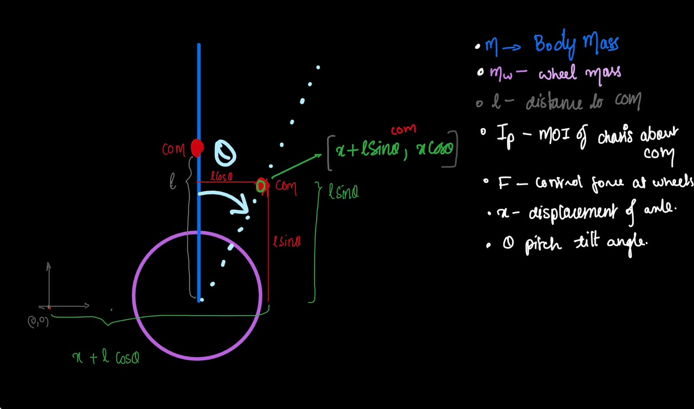
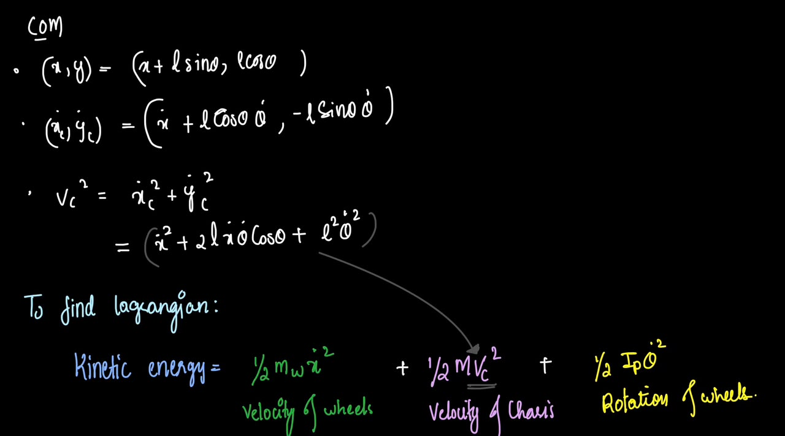
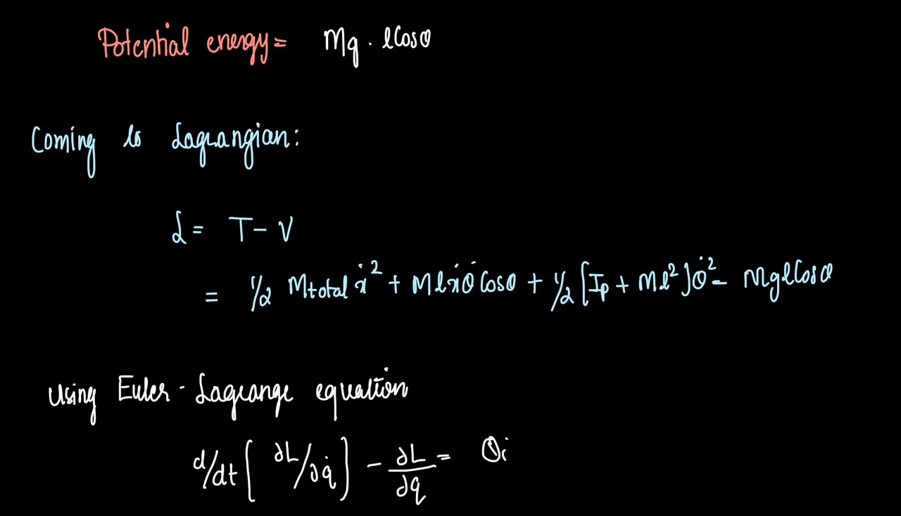
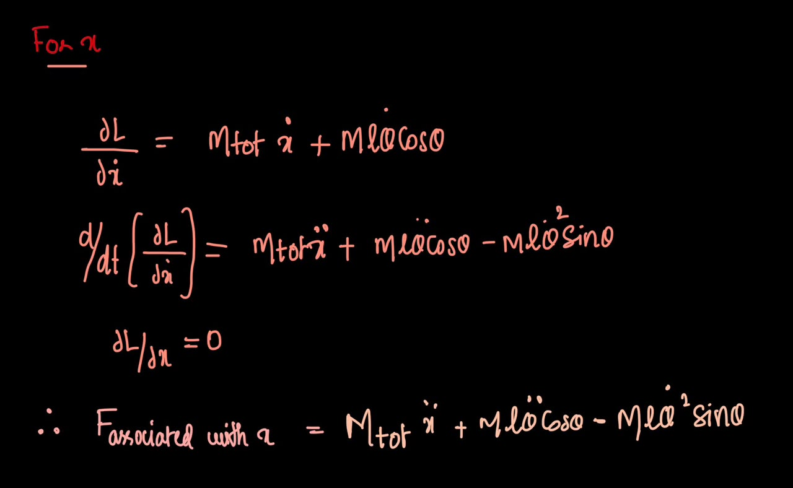
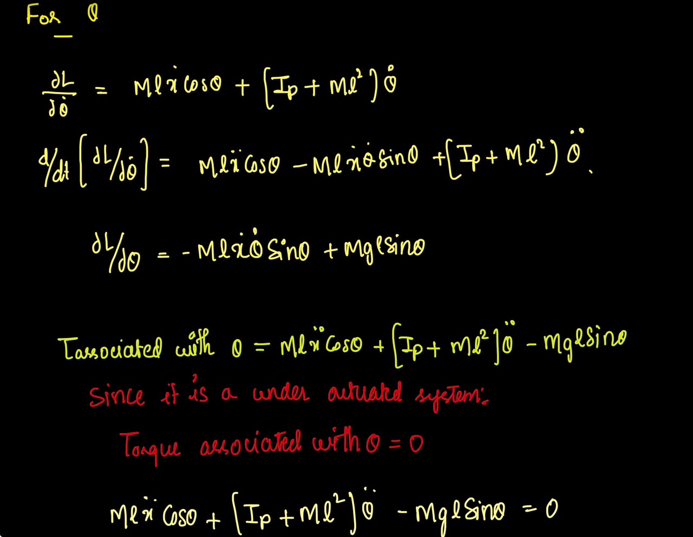
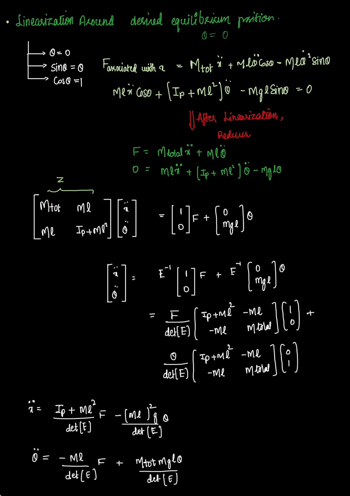
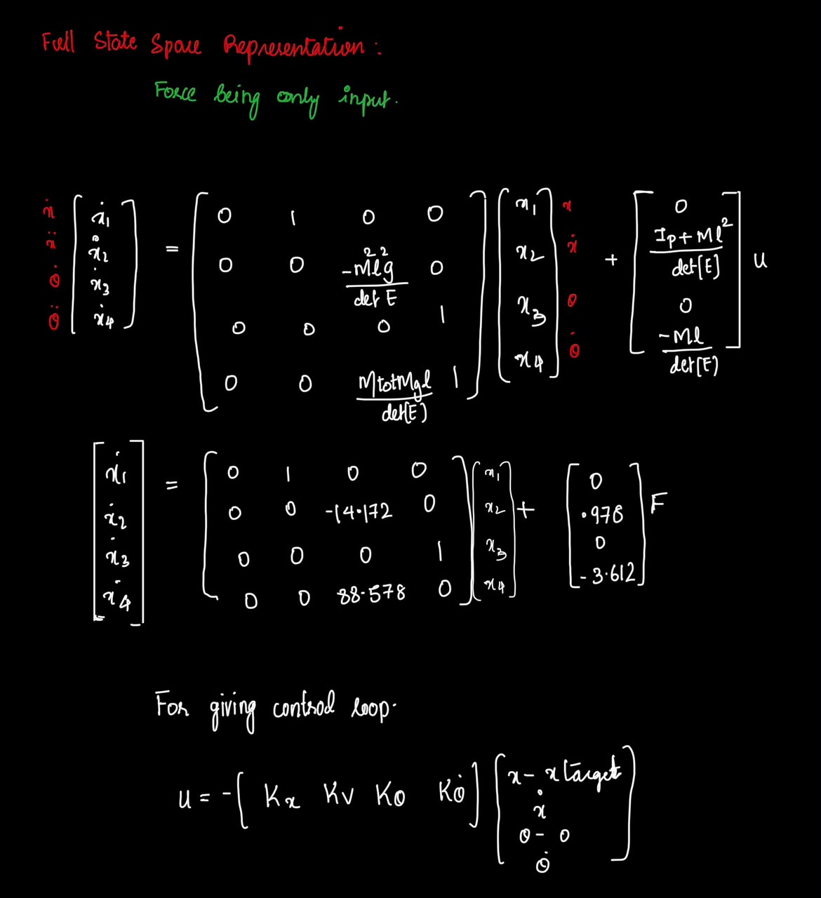

# Self-Balancing Robot — Inverted Pendulum Dynamics & Control

A two-wheeled self-balancing robot project modeled using **inverted pendulum on wheels** dynamics. It combines mathematical modeling (linearized state-space & equations of motion), MATLAB control simulations, and a full **ROS 2 Jazzy + Gazebo** physics simulation.

---

## Project Overview

1. **System Modeling & Dynamics**
   - Derived the nonlinear equations of motion for a two-wheeled inverted pendulum robot and linearized them around the upright equilibrium ($\theta \approx 0$).
   - Formulated the 4-state linear state-space model $\dot{x} = Ax + Bu$ with state vector $x = [\text{position},\ \text{velocity},\ \text{pitch angle},\ \text{pitch rate}]^T$.

2. **Control Strategies (MATLAB)**
   - **Inner-Loop Pitch PID ([balance_test.m](self_balancing_sim/balance_test.m))**: Stabilizes the robot upright from an initial tilt angle using PID feedback on pitch $\theta$ and pitch rate $\dot{\theta}$.
   - **Cascaded Position + Pitch Control ([full_cascade_sim.m](self_balancing_sim/full_cascade_sim.m))**: Combines an outer position PD loop (generating a clamped target lean angle) with the inner pitch PID loop so the robot drives to a target position and holds balance.
   - **State-Space Pole Placement ([matrix_statespace_sim.m](self_balancing_sim/matrix_statespace_sim.m))**: Computes open-loop (`eig(A)`) and closed-loop (`eig(A - B*K)`) poles directly from the derived matrices, plots the s-plane pole map, and compares open-loop vs. closed-loop time responses.

3. **ROS 2 Jazzy & Gazebo Simulation (`self_balancing_sim/`)**
   - Full URDF/Xacro robot model with chassis, wheels, IMU sensor, and differential drive plugin.
   - 100 Hz ROS 2 PID controller node (`pid_controller_node.py`) and parameter/gain solver (`pid_gain_solver.py`).

---

## Repository Structure

```text
self-balancing-robot/
├── docs/
│   └── state_space_notes/                    # Handwritten state-space derivation notes
│       ├── state_space_derivation_01.jpeg
│       ├── state_space_derivation_02.jpeg
│       ├── state_space_derivation_03.jpeg
│       ├── state_space_derivation_04.jpeg
│       ├── state_space_derivation_05.jpeg
│       ├── state_space_derivation_06.jpeg
│       └── state_space_derivation_07.jpeg
└── self_balancing_sim/                       # ROS 2 Jazzy + Gazebo package & MATLAB scripts
    ├── Inverted_Pendulum_Dynamics_and_PID_Equations.pdf
    ├── balance_test.m                        # Pitch stabilization PID simulation
    ├── full_cascade_sim.m                    # Cascaded position PD + pitch PID simulation
    ├── matrix_statespace_sim.m               # State-space (A, B, K) pole analysis & simulation
    ├── launch/
    ├── urdf/
    ├── worlds/
    └── self_balancing_sim/                   # ROS 2 Python nodes
```

---

## Quick Start (ROS 2 Jazzy)

```bash
colcon build --symlink-install --packages-select self_balancing_sim
source install/setup.bash
ros2 launch self_balancing_sim sim.launch.py
```

See [self_balancing_sim/README.md](self_balancing_sim/README.md) for full ROS 2 package details.

---

## Equations & Handwritten State-Space Notes

- **Equations Reference**: [Inverted_Pendulum_Dynamics_and_PID_Equations.pdf](self_balancing_sim/Inverted_Pendulum_Dynamics_and_PID_Equations.pdf)
- **Handwritten State-Space Derivation**:

| Page 1 | Page 2 | Page 3 | Page 4 |
| :---: | :---: | :---: | :---: |
|  |  |  |  |

| Page 5 | Page 6 | Page 7 |
| :---: | :---: | :---: |
|  |  |  |
